<div align="center">

# TeslaX — Tesla Futuristic

**An unofficial, cinematic concept site for Tesla: the line-up, energy, charging, ownership and a small store.**

A long-scroll homepage for the Model S Plaid, plus 34 sub-pages for every link in the navigation: each model, inventory, compare, trade-in and fleet; Energy and Charging; thirteen Discover pages; a savings calculator; an updates archive with an article for each story; and a shop with a real cart and checkout. Plain HTML, compiled Tailwind and GSAP, with no framework.

[**Open the live site**](https://denysovski.github.io/TeslaFuturistic/) &nbsp;·&nbsp; [Vehicles](https://denysovski.github.io/TeslaFuturistic/vehicles/) &nbsp;·&nbsp; [Energy](https://denysovski.github.io/TeslaFuturistic/energy/) &nbsp;·&nbsp; [Shop](https://denysovski.github.io/TeslaFuturistic/shop/) &nbsp;·&nbsp; [Compare savings](https://denysovski.github.io/TeslaFuturistic/savings/)


<br>

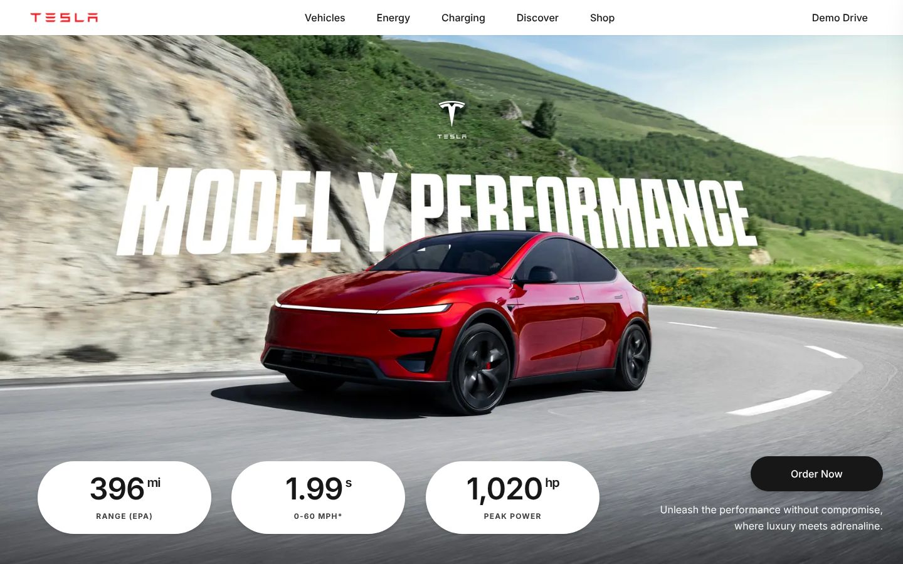

</div>

> [!NOTE]
> **Unofficial concept.** A portfolio project, not affiliated with, endorsed or sponsored by Tesla, Inc. Tesla, Model S, Model 3, Model X, Model Y, Cybertruck, Powerwall and Megapack are trademarks of Tesla, Inc.; product photos © Tesla, Inc. Prices, dates, stock and the store are demo data, and no form sends anything.

---

## At a glance

| | |
|---|---|
| **Pages** | 35 static pages. The homepage, and a page for every navigation link: five models, line-up, inventory (new and used), compare, trade-in, fleet, Energy (Solar Panels, Solar Roof, Powerwall, Megapack), Charging (charging, home, Supercharging), thirteen Discover pages, Compare savings, the updates archive with six articles, and the shop. |
| **Navigation** | One solid white header on every page. It slides away while you scroll down and comes back the moment you scroll up. Desktop mega menus open on click, keyboard or hover; hovering a tile only enlarges its picture. On phones the menu button sits next to the cart and the menu is pulled down from under the bar, with an accordion for each section. In-page links glide to their section. |
| **Shop** | Sixteen products drawn as line icons rather than photos, filtered by category. Buy two items and save 10 %, three or more and save 15 %, free shipping from $100. A cart drawer with quantities, undo and a progress bar to the next saving, and a checkout with an order summary. |
| **Tools** | An order configurator with monthly payments on every model page, plus estimators for trade-in value, savings against petrol, insurance and road-trip charging stops. |
| **Images** | WebP from 640 to 3200 px with `srcset`. A small script tells the browser how wide each photo is really drawn when it is cropped with `object-fit: cover`, so phones get sharp files instead of stretched ones. The phone hero is an art-directed portrait crop. |
| **Content** | About tells the company story from 2003 to today with a deliveries chart; Careers has six team cards, twenty roles with a team filter and a LinkedIn card; Collision Center and Certified Installer answer common questions in accordions. |
| **Quality** | No sideways scrolling at 320, 390, 768 or 1440 px on any page, no axe violations (WCAG 2.1 AA and best practice) at 390 and 1440 px, and a clean scan of the [XSLOP](https://github.com/denysovski/xslop) design rules. |

---

## The homepage

| | |
|:---:|:---:|
| 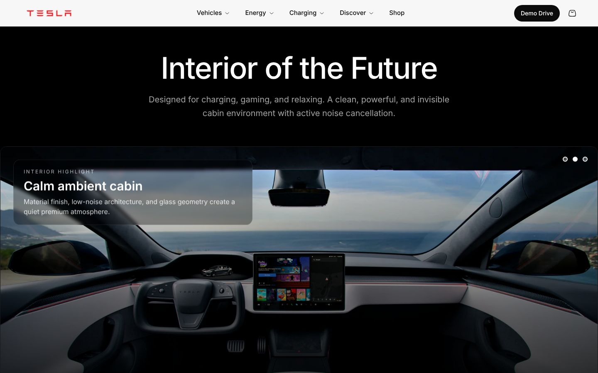 **Interior of the Future.** A cabin gallery that plays on its own; on phones the photo keeps its shape and the caption and stats sit below it. |  **High Impact Protection.** The two notes sit in the top corners of the photo at every size. |
| 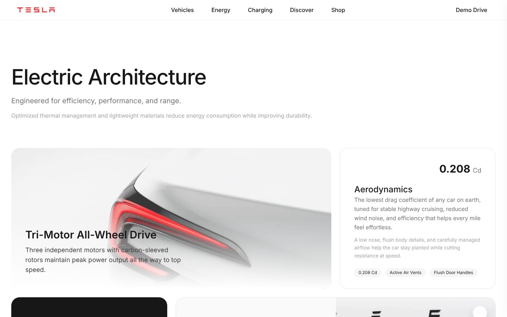 **Electric Architecture.** A bento grid; on phones each card grows with its text. |  **Our showcase.** A fanned deck on desktop; on phones one card with arrows and swipe. |
|  **Complete Energy Ecosystem.** Solar roof, Powerwall and the app as one system. |  **Latest Updates.** Every card opens its story in the archive. |

## The sub-pages

| | |
|:---:|:---:|
| 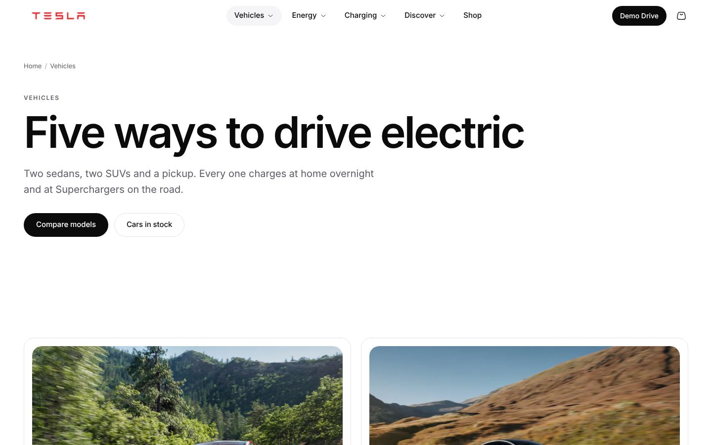 **Vehicles.** The line-up with range, acceleration and price for each model. | 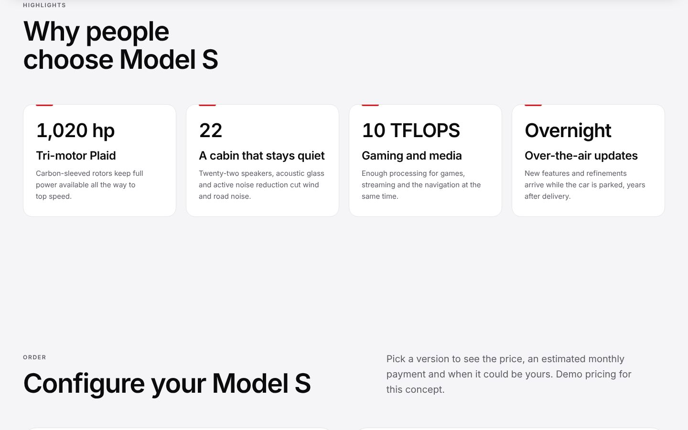 **A model page.** Highlights led by a number, a configurator and the specifications. |
| 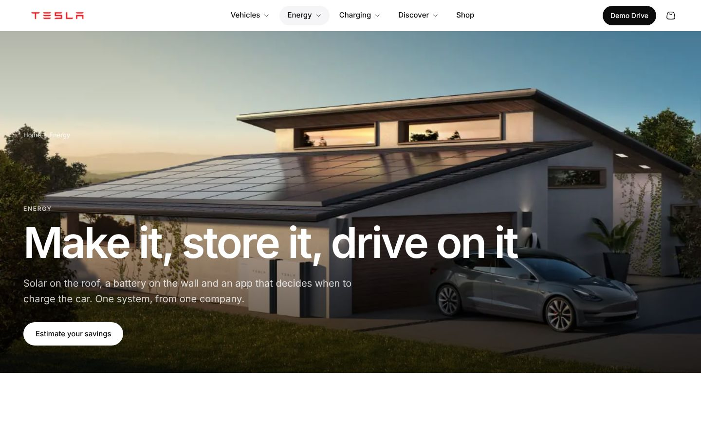 **Energy.** Solar Panels, Solar Roof, Powerwall and Megapack on one page, each with its own anchor. | 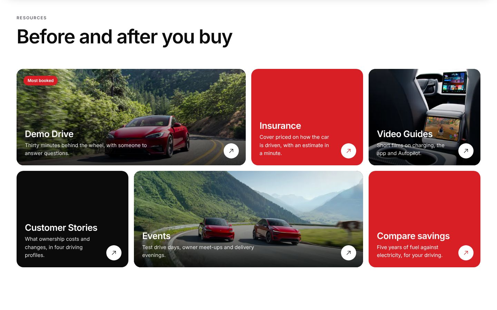 **Discover.** Photo, red and black cards leading to thirteen pages. |
| 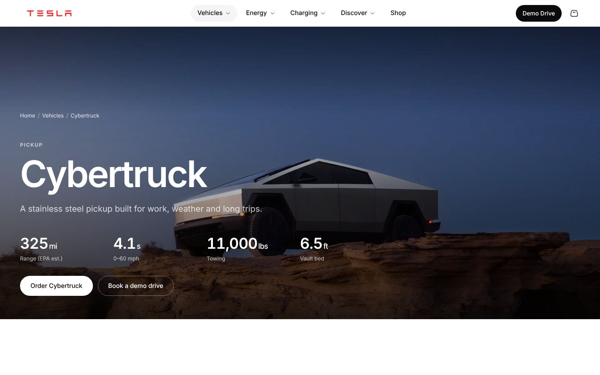 **Cybertruck.** Its own photos, specs, highlights and a configurator. | 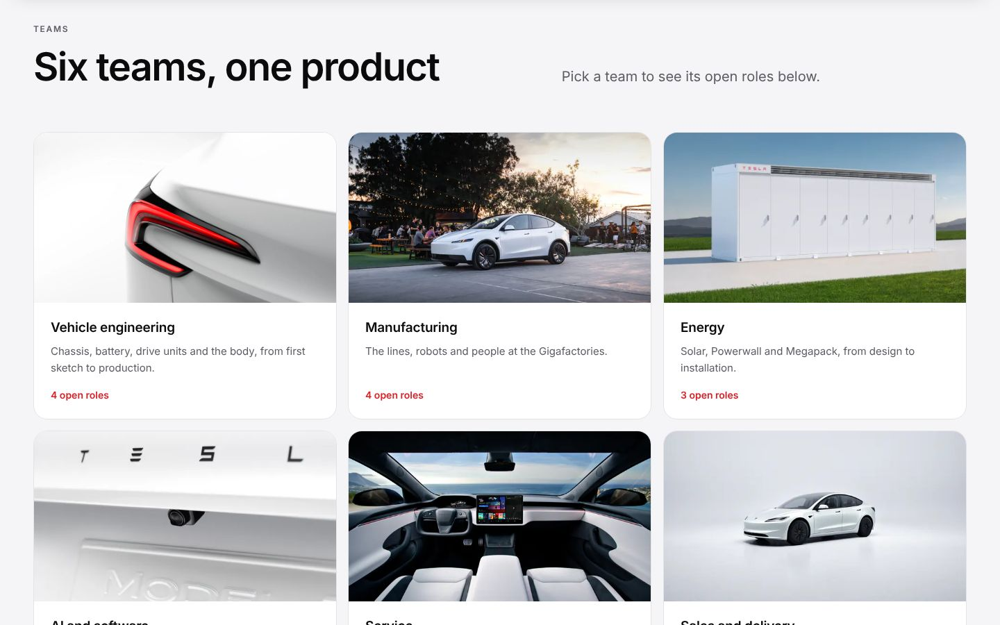 **Careers.** Six teams, twenty roles with a filter, and a LinkedIn card. |
| 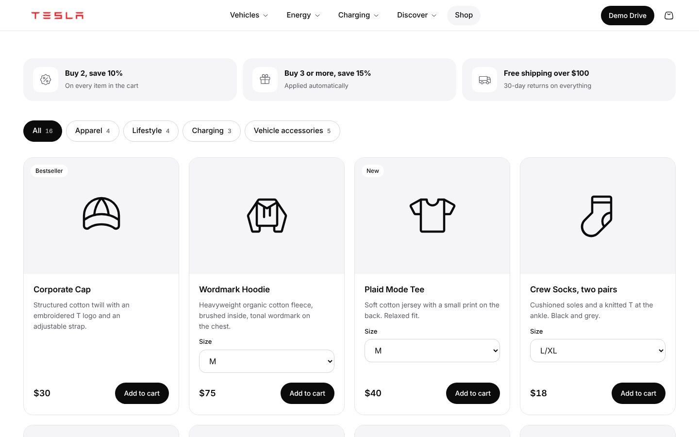 **Shop.** Products as icons, multi-buy savings and category filters. | 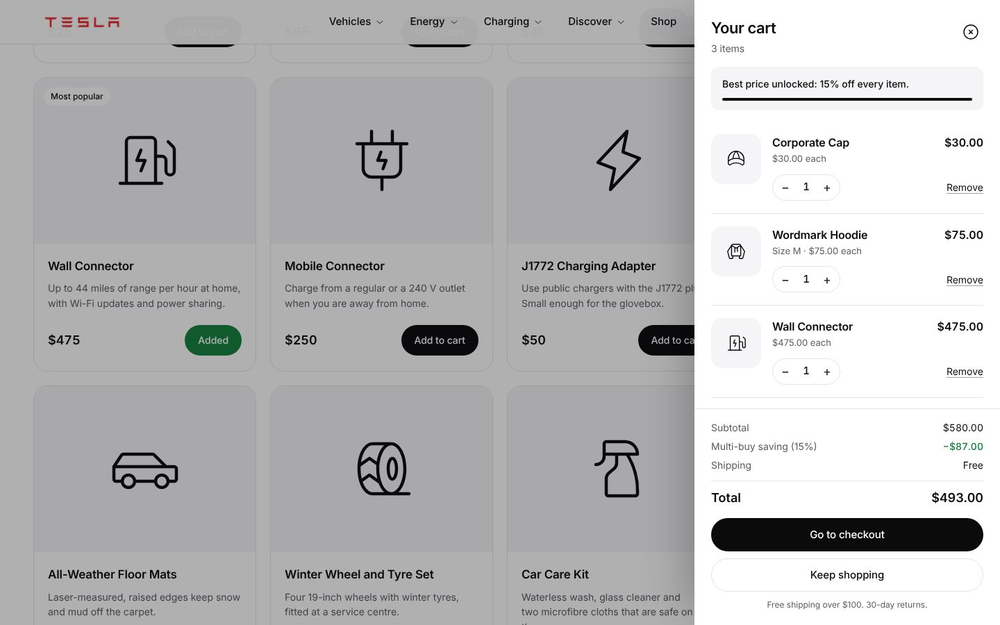 **Cart.** Quantities, the saving applied and the total before checkout. |

| | |
|:---:|:---:|
| 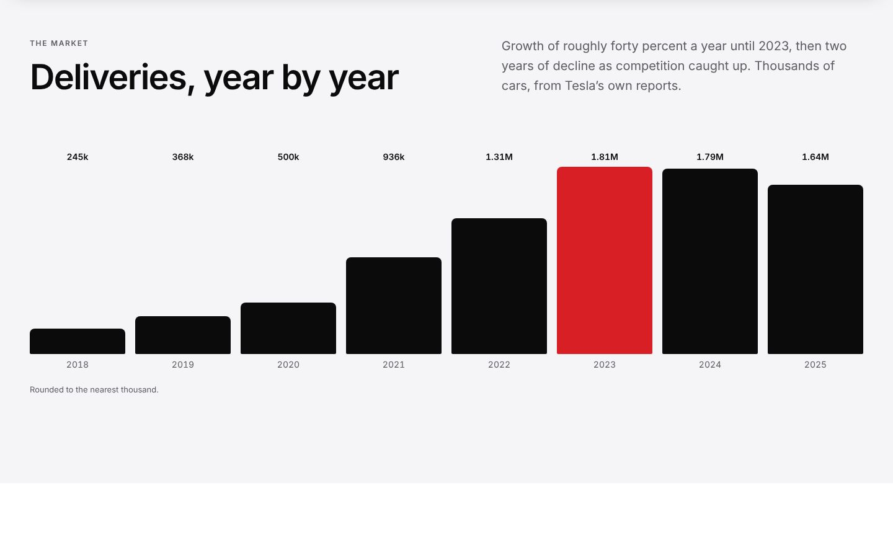 **About.** The story in six chapters and deliveries year by year. | 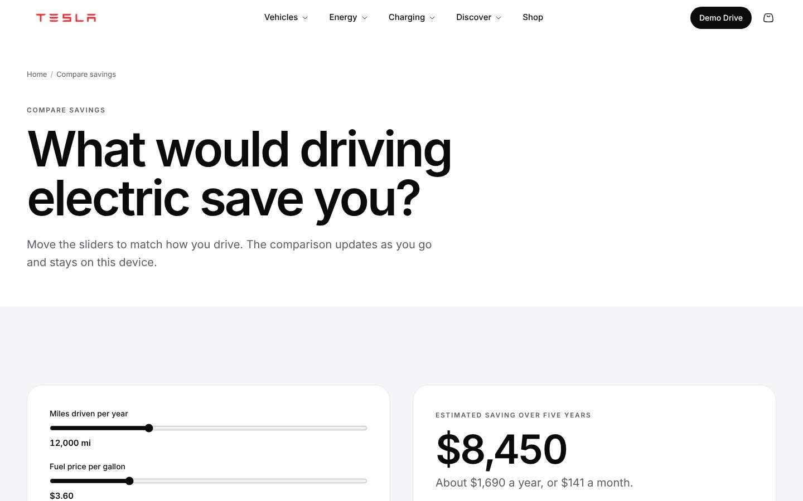 **Compare savings.** Mileage, fuel price, economy and electricity rate against five years of running costs. |

---

## On a phone

| | | |
|:---:|:---:|:---:|
| 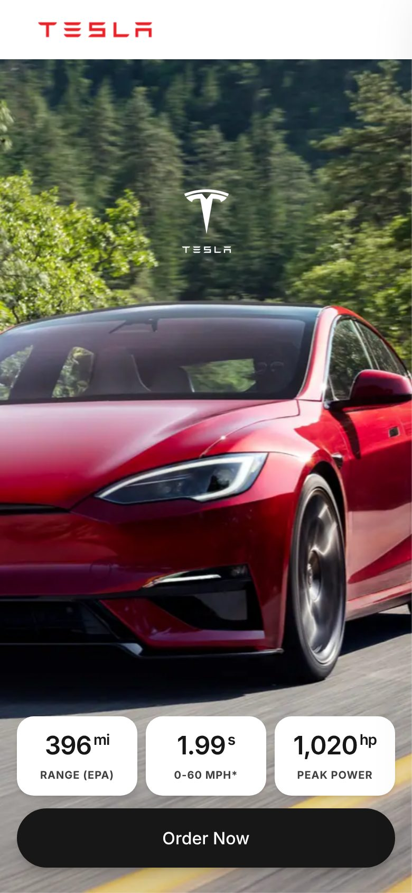<br><sub>Hero</sub> | 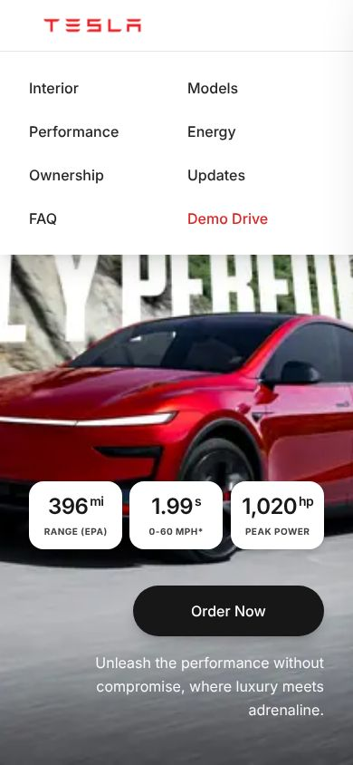<br><sub>Menu</sub> | <br><sub>Our showcase</sub> |
| <br><sub>Energy</sub> | 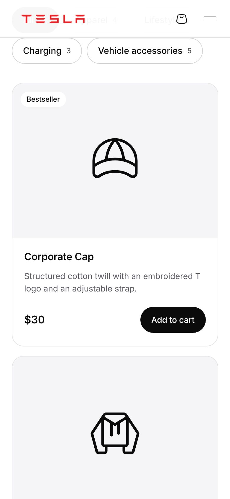<br><sub>Shop</sub> | <br><sub>Interior</sub> |

---

## Performance, SEO and accessibility

- **Images.** Each photo exists at up to six widths with fixed dimensions, lazy loading below the fold and a preloaded hero per breakpoint. 61 scroll frames as small WebP files, a desktop and a phone set.
- **No runtime CDNs.** Tailwind is compiled, Inter is self-hosted, GSAP is bundled, and only the icons the site uses are bundled with it, so icons never wait for an API.
- **Search.** A unique title, description and canonical URL on every page, Open Graph and Twitter cards, breadcrumbs as `BreadcrumbList`, models as `Product`, the shop as an `ItemList`, the FAQ as `FAQPage`, and a sitemap with all 29 URLs.
- **Accessibility.** A skip link, one `h1` per page with no skipped heading levels, labelled form fields with errors next to the field, focus moved to the first problem, keyboard-operable menus and filters, and `prefers-reduced-motion` respected.
- **Motion.** Reveals rise and fade once; filters fade out, swap and rise back in; menus and the cart slide on a single easing curve.

---

## Under the hood

- **Vite 8** multi-page build; every page is an `index.html` in its own folder
- **Tailwind CSS 3** and a small hand-written layer for the shared components
- **GSAP 3 + ScrollTrigger** on the homepage, **Iconify** icons bundled offline
- **sharp** for the image pipeline
- Deployed to **GitHub Pages** on every push to `master`

```
index.html                    the homepage
scripts/site/                 templates: navigation, layout, building blocks and every sub-page
scripts/build-pages.mjs       writes the sub-pages and the sitemap (output is git-ignored)
scripts/build-icons.mjs       bundles only the icons the pages use
scripts/optimize-images.mjs   rebuilds public/img/ from originals in assets-src/
src/shared.js · ui.css        header, phone menu, cart, reveals and sharp images on every page
src/home.js · home.css        the homepage: scroll sequence, gallery, showcase
src/widgets.js                filters, calculators, forms and the shop checkout
public/                       images, og-image, favicons, robots, llms.txt, manifest, 404
```

Edit a sub-page in `scripts/site/`, not in the generated HTML: `npm run dev` and `npm run build` regenerate them.

## Run it locally

```bash
npm install
npm run dev       # writes the pages, then starts the dev server
npm run build     # production build into dist/
npm run preview   # serve the build
npm run images    # rebuild public/img/ from originals in assets-src/
```

The original, full-size photos are not committed. Put them in `assets-src/` (they are in the git history) before running `npm run images`.

---

<div align="center"><sub>Unofficial concept by <a href="https://github.com/denysovski">denysovski</a>. Not affiliated with Tesla, Inc.</sub></div>
