<div align="center">

# TeslaX — Tesla Futuristic

**An unofficial, cinematic concept page for the Tesla Model S Plaid.**

One scroll from the first frame to the long-term value: interior, gaming, safety, the electric architecture, the line-up, Tesla Energy, performance, ownership costs and a demo-drive booking. Plain HTML, compiled Tailwind and GSAP, with no framework and no app shell.

[**Open the live site**](https://denysovski.github.io/TeslaFuturistic/) &nbsp;·&nbsp; [Models](https://denysovski.github.io/TeslaFuturistic/#models) &nbsp;·&nbsp; [Performance](https://denysovski.github.io/TeslaFuturistic/#performance) &nbsp;·&nbsp; [Demo Drive](https://denysovski.github.io/TeslaFuturistic/#demo-drive)


<br>


</div>

> [!NOTE]
> **Unofficial concept.** A portfolio project, not affiliated with, endorsed or sponsored by Tesla, Inc. Tesla, Model S, Model 3, Model X, Model Y, Powerwall and Megapack are trademarks of Tesla, Inc.; product photos © Tesla, Inc. Prices, dates and the cart are demo data.

---

## At a glance

| | |
|---|---|
| **The page** | One long, crawlable page in fifteen sections, each with its own anchor, from the hero to *What's the future like?* |
| **Motion** | GSAP + ScrollTrigger reveals, a 61-frame scroll sequence for the hero, sliding model cards, an auto-playing interior gallery and quiet hover states. |
| **Interaction** | Spec tooltips on the hero stats, a model switcher with live specs, mega menus, a cart drawer, an FAQ accordion and a two-step demo-drive form. |
| **Performance** | Every image in WebP at three or four widths with `srcset`, fixed dimensions, lazy loading below the fold and a preloaded hero. About 200 MB of assets became under 7 MB. |
| **SEO** | One `h1`, canonical URL, Open Graph and Twitter cards, JSON-LD (`WebSite`, `WebPage`, `FAQPage`), sitemap, robots, `llms.txt`, a web manifest and a real 404. |
| **Responsive** | Tuned for phones, tablets and desktop: compact hero stats, readable cards, a working mobile menu and no sideways scrolling. |

---

## The page

| | |
|---|---|
|  **Hero.** Model Y Performance at full bleed, the Tesla mark and three hero stats (range, 0–60, peak power), each with a tooltip on hover. |  **Interior of the Future.** A cabin gallery that plays on its own, with a glass caption card for each view. |
| 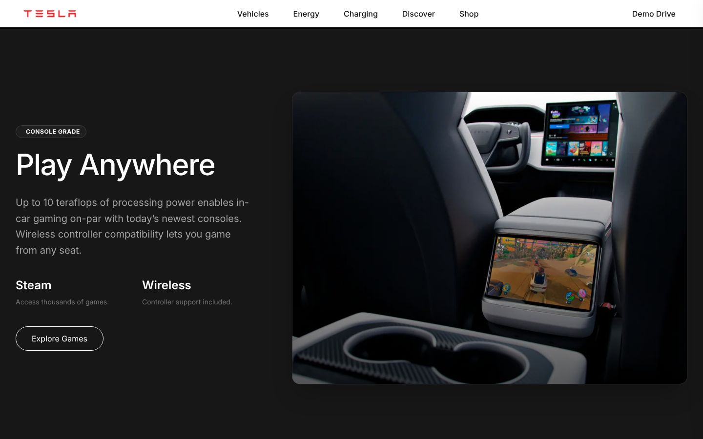 **Play Anywhere.** In-car gaming on the rear display, with Steam and wireless controller support. | 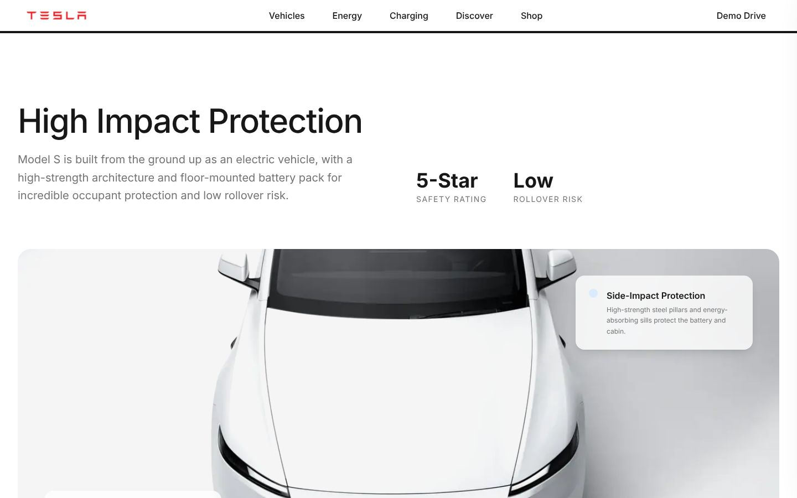 **High Impact Protection.** The safety story around the white Model S, with floating notes on the structure. |
|  **Electric Architecture.** A bento grid: tri-motor drive, 0.208 Cd aerodynamics, Supercharging and vision processing. | 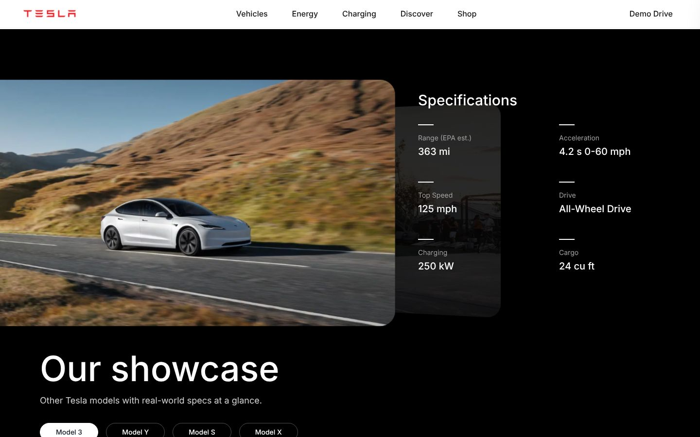 **Our showcase.** A deck of four models. Switch between Model 3, Y, S and X and the specification panel updates. |
| 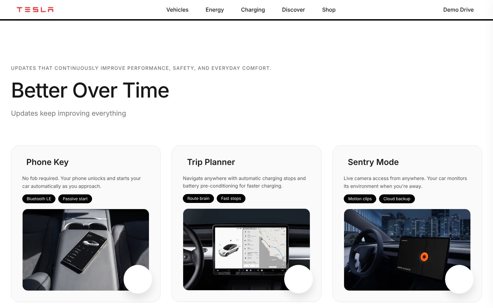 **Better Over Time.** Phone Key, Trip Planner and Sentry Mode as three product cards. | 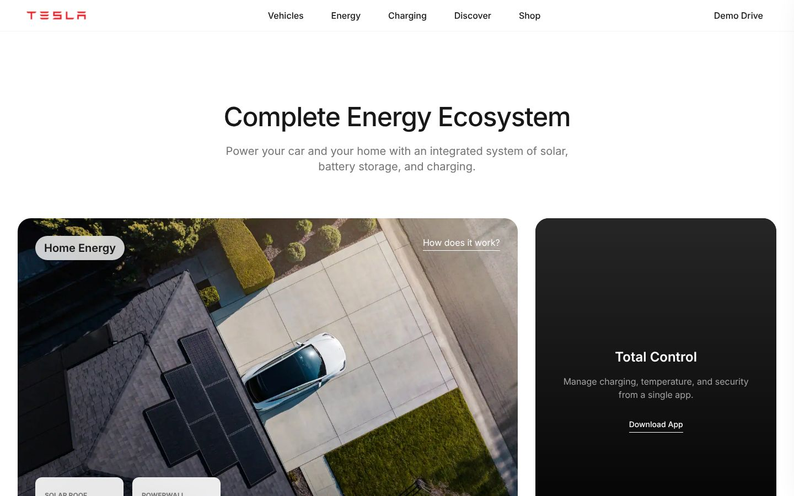 **Complete Energy Ecosystem.** Solar roof, Powerwall and the app as one system. |
| 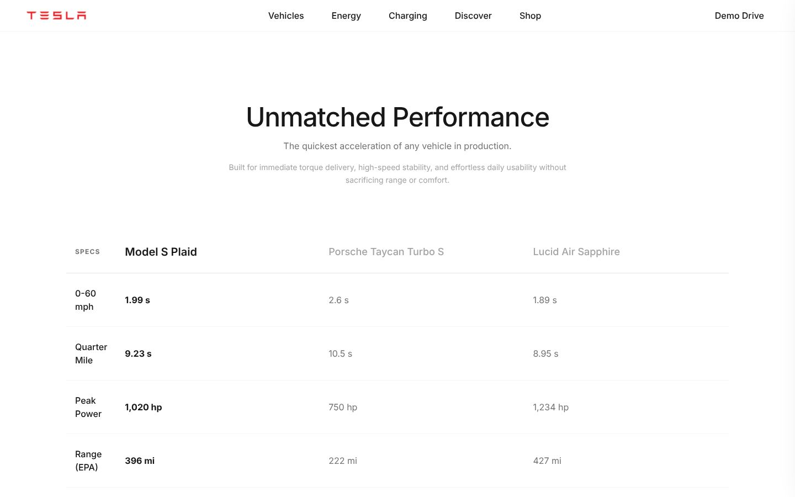 **Unmatched Performance.** Model S Plaid against the Porsche Taycan Turbo S and Lucid Air Sapphire. | 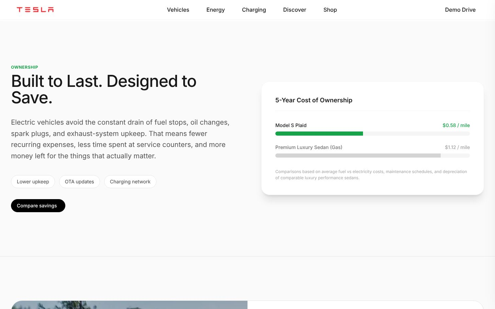 **Built to Last.** Lower upkeep and a five-year cost-per-mile comparison. |
| 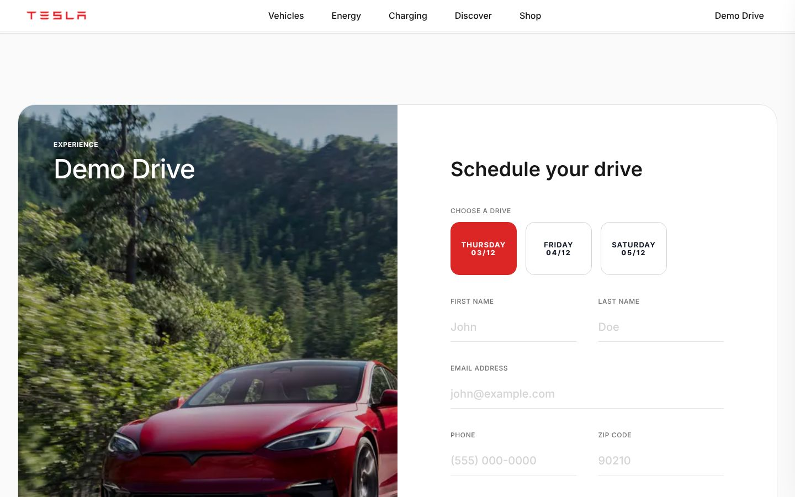 **Demo Drive.** Pick a day, leave your details, done. A demo form: nothing is sent or stored. | 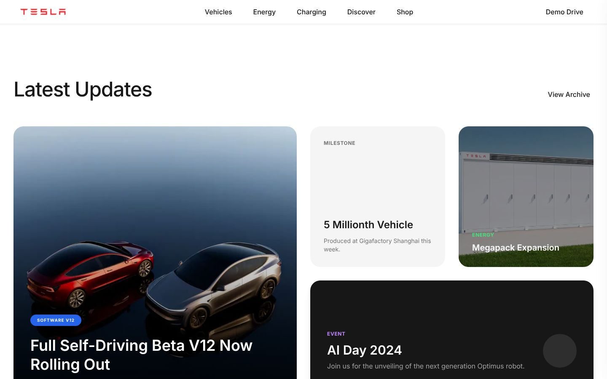 **Latest Updates.** Software, milestones and events in an editorial grid. |
| 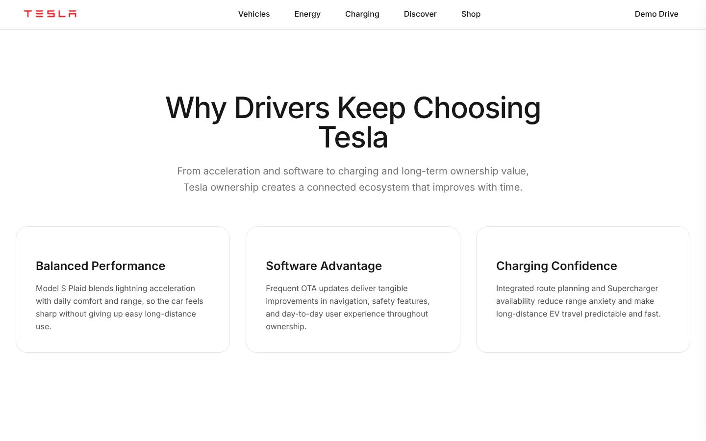 **Why Drivers Keep Choosing Tesla.** Performance, software and charging in three short arguments. | 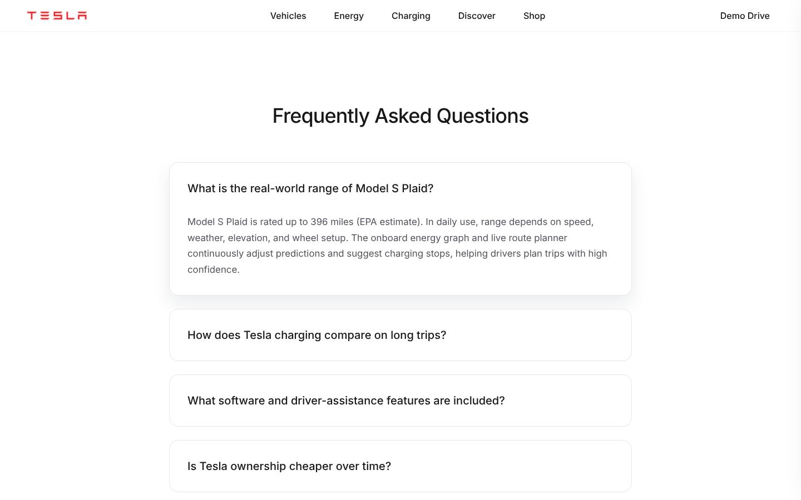 **Frequently Asked Questions.** Range, long-trip charging, software and cost of ownership, also published as `FAQPage` structured data. |

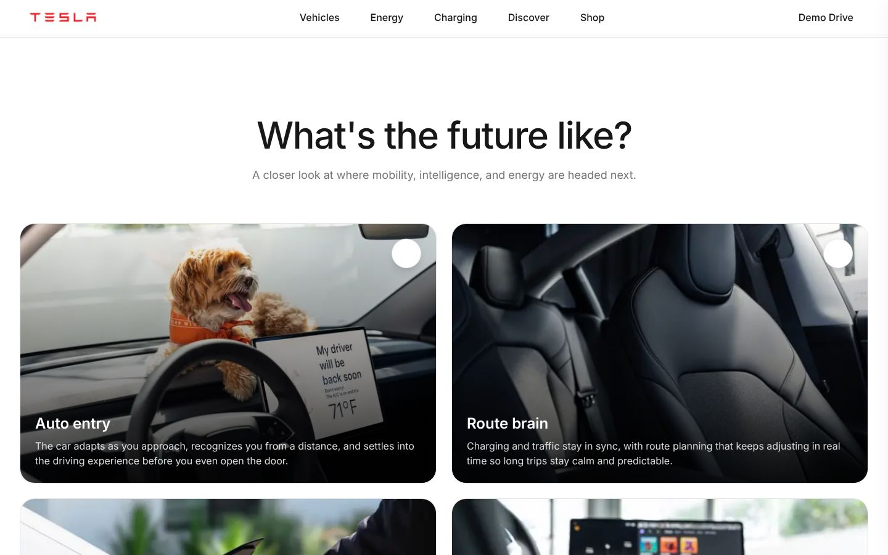
**What's the future like?** Four large cards on where mobility, intelligence and energy are heading next.

---

## Mobile

| | | |
|:---:|:---:|:---:|
| <br><sub>Hero</sub> | <br><sub>Menu</sub> | 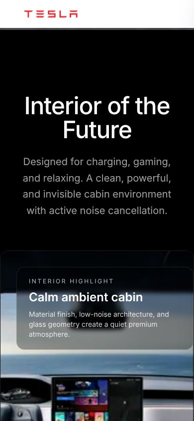<br><sub>Interior</sub> |
| 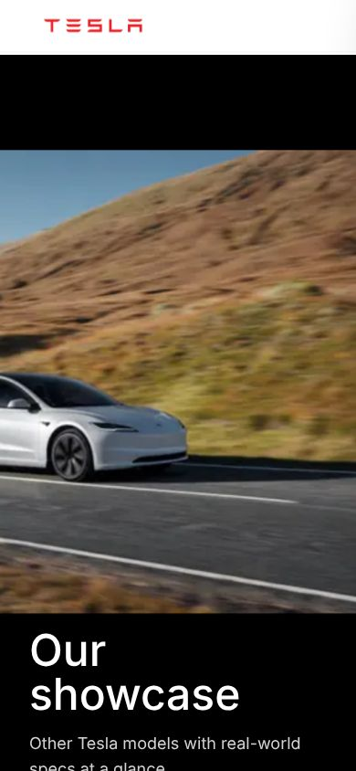<br><sub>Our showcase</sub> | 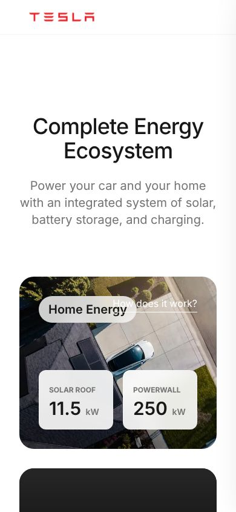<br><sub>Energy</sub> | 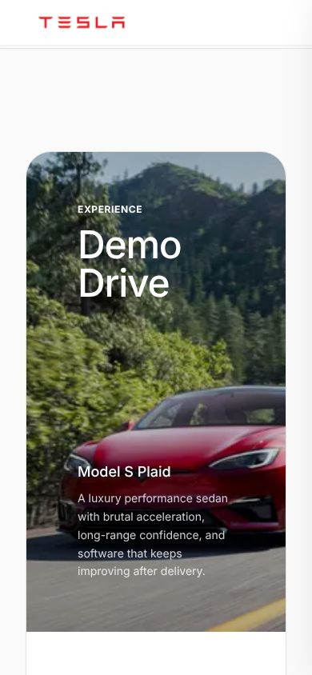<br><sub>Demo Drive</sub> |

---

## Performance and SEO

### Images

- **WebP at the right size.** Each photo exists at three or four widths (`640`, `1280`, `1920`, up to `2560` for the hero) with `srcset` and `sizes`, so a phone never downloads a desktop file.
- **No layout shift.** Every image carries its `width` and `height`.
- **Loaded when needed.** Everything below the first screen is `loading="lazy"`; the hero is preloaded with `fetchpriority="high"`.
- **The scroll sequence.** 61 frames as small WebP files, a 1600 px set for desktop and a 960 px set for phones (they were 1.3 MB PNGs each).
- **Descriptive names.** `model-s-interior-cockpit-1280.webp`, not `ModelS_82.jpg`.

### Search and sharing

- One `h1` and an anchor on every section; every link leads somewhere real.
- Canonical URL, meta description, Open Graph and Twitter cards with a 1200 × 630 share image.
- JSON-LD for `WebSite`, `WebPage` and the FAQ as `FAQPage`.
- `robots.txt`, `sitemap.xml`, `llms.txt`, `site.webmanifest`, favicons and a real `404.html`.

### Build

- Tailwind is compiled at build time from the classes in the page (no runtime CDN), and Inter is self-hosted (no Google Fonts request).
- GSAP loads at the end of the body and the icon library is deferred, so nothing blocks the first paint.

---

## Under the hood

- **Vite 8** static build: `index.html` *is* the page, with its markup, styles and script
- **Tailwind CSS 3**, compiled from the page's classes, plus a small layer of custom CSS for the motion
- **GSAP 3 + ScrollTrigger** for reveals and the scroll sequence, **Iconify** for icons
- **Inter** (variable), self-hosted through Fontsource
- **sharp** for the image pipeline
- Deployed to **GitHub Pages** on every push to `master`

```
index.html                    the page: markup, page styles and page script
src/main.js · src/main.css    Tailwind and the Inter font for the build
public/img/                   optimised images (<name>-<width>.webp)
public/img/hero-sequence/     scroll frames, 1600 px and 960 px sets
public/                       og-image, favicons, robots, sitemap, llms.txt, manifest, 404
scripts/optimize-images.mjs   rebuilds public/img/ from originals in assets-src/
docs/screens/                 screenshots for this README
```

## Visual style

- White and off-white surfaces for reading, deep black and charcoal for structure
- Soft grey borders and muted interface chrome
- Tesla red as the single accent
- Glass cards, gentle blur and long, smooth fades

## Run it locally

```bash
npm install
npm run dev       # dev server
npm run build     # production build into dist/
npm run preview   # serve the build
npm run images    # rebuild public/img/ from originals in assets-src/
```

The original, full-size photos are not committed. Put them in `assets-src/` (they are in the git history) before running `npm run images`.

---

<div align="center"><sub>Unofficial concept by <a href="https://github.com/denysovski">denysovski</a>. Not affiliated with Tesla, Inc.</sub></div>
